# ⚾ 야구 원정 팬을 위한 여행 코스 추천 앱

> 야구 경기 관람과 지역 관광을 연결하는 맞춤형 여행 서비스

## 📱 프로젝트 소개

국내 야구 원정 팬들을 위한 맞춤형 여행지 추천 모바일 애플리케이션입니다.
관광공사의 오픈 데이터를 활용하여 홈구장 주변의 관광지와 명소를 소개하고 사용자의 성향에 맞는 맞춤형 관광 코스를 추천합니다.
또한 야구팬들이 쉽게 직관 동행을 찾고 실시간으로 소통할 수 있는 커뮤니티 기능을 제공합니다.

### 주요 기능

- **홈 (맞춤형 여행지 추천)**

  - 사용자 선호 구단 기반 홈구장 주변 관광지 추천
  - 가입 시 선택한 여행 성향에 기반한 맞춤 여행지 추천
  - 관광공사 국문 관광 정보 데이터 기반 명소/맛집 정보 제공

- **동행찾기**

  - 야구 직관 및 여행 동행 모집 게시판
  - 실시간 1:1 및 그룹 채팅 (Socket.IO)
  - 게시글 검색, 스크랩, 차단 기능

- **이야기방**

  - 제한 시간 내 실시간 소통 공간
  - 주제별(야구/뉴스/일상/연애) 대화방 생성
  - 실시간 참여 인원 및 남은 시간 표시

- **마이페이지**
  - 프로필 관리 (닉네임, 성별, 소개글, 프로필 이미지)
  - 선호 구단 설정
  - 나의 여행 일지 (MyTravelinning)
  - 스크랩/차단 목록 관리
  - 로그아웃/회원탈퇴

---

## 📱 실행 화면

### 온보딩 & 로그인

|                         온보딩                         |                         로그인                          |                 회원가입                  |                   비밀번호 변경                   |
| :----------------------------------------------------: | :-----------------------------------------------------: | :---------------------------------------: | :-----------------------------------------------: |
|  | 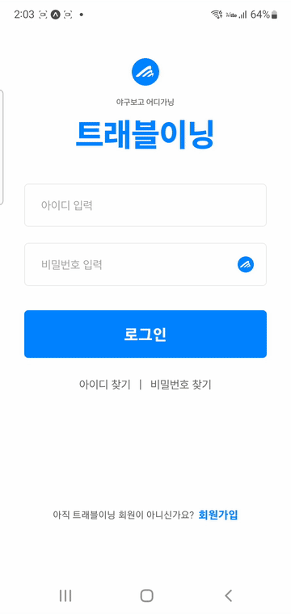 | 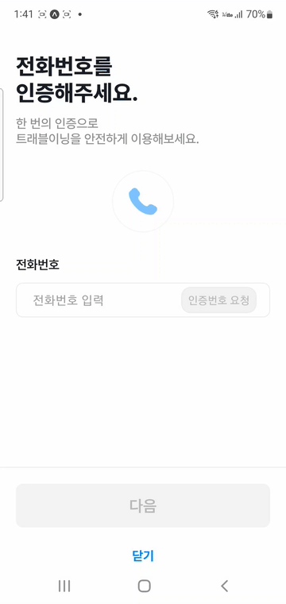 |  |

### 홈 & 여행 추천

|             홈 화면             |                     구단변경                      |                   필터링                   |
| :-----------------------------: | :-----------------------------------------------: | :----------------------------------------: |
| 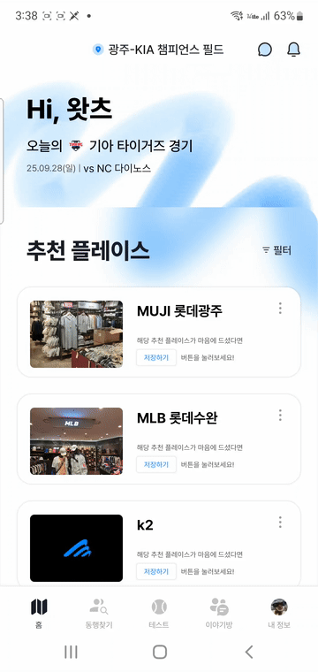 | 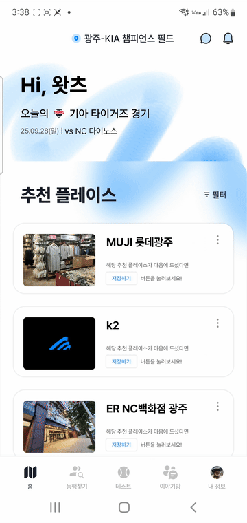 |  |

### 동행찾기

#### 동행찾기 게시글

|                 게시글 목록                 |                  게시글 작성                  |                  게시글 수정                  |                  게시글 삭제                  |                  게시글 상태변경                   |
| :-----------------------------------------: | :-------------------------------------------: | :-------------------------------------------: | :-------------------------------------------: | :------------------------------------------------: |
| 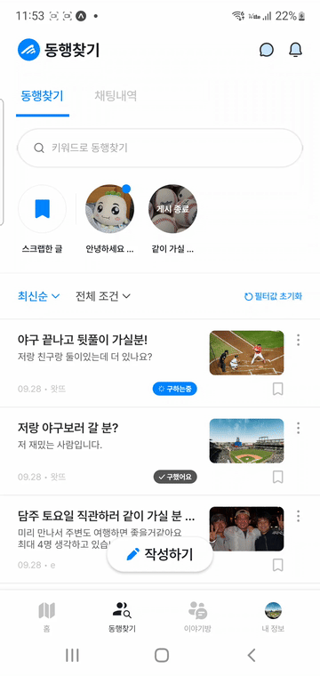 | 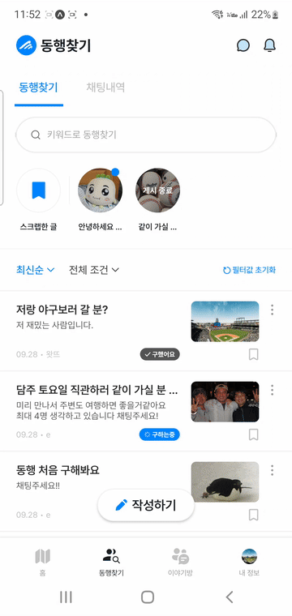 | 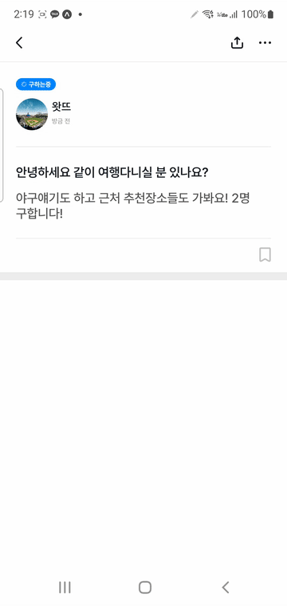 | 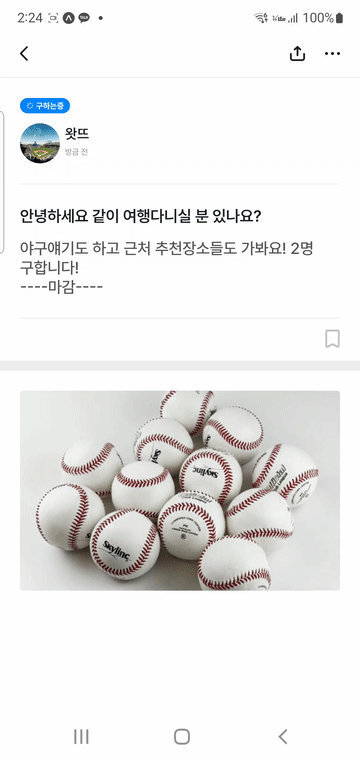 | 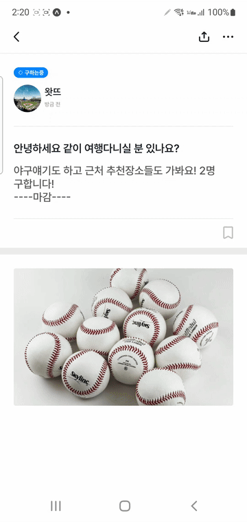 |

#### 동행찾기 채팅

|               채팅 목록                |                 그룹채팅 참가(참가자)                  |               그룹채팅 초대(작성자)               |              채팅방 나가기               |
| :------------------------------------: | :----------------------------------------------------: | :-----------------------------------------------: | :--------------------------------------: |
| 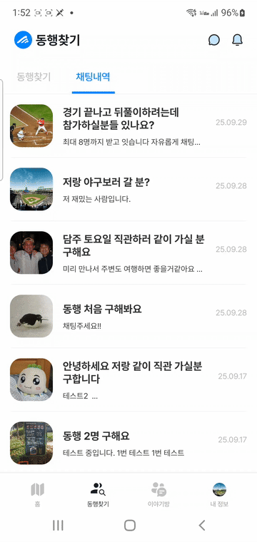 | 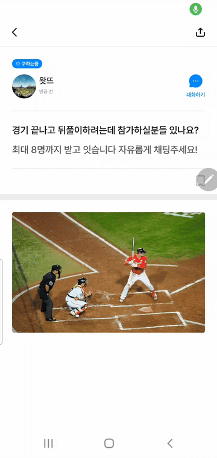 | 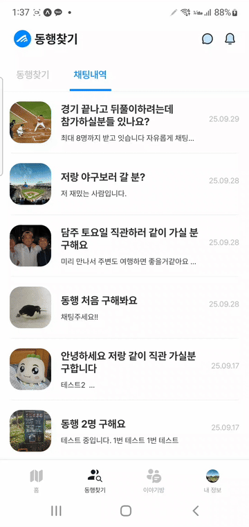 | 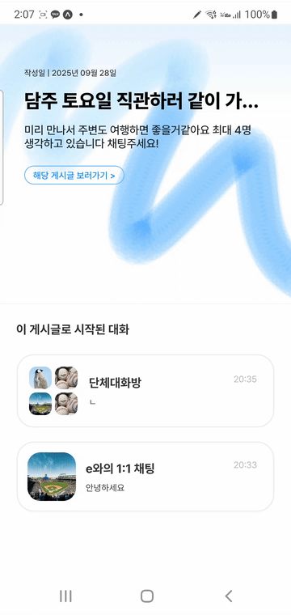 |

### 이야기방

|                      필터링                      |                    방 생성                     |                   방 입장                    |                      방 나가기                      |
| :----------------------------------------------: | :--------------------------------------------: | :------------------------------------------: | :-------------------------------------------------: |
| 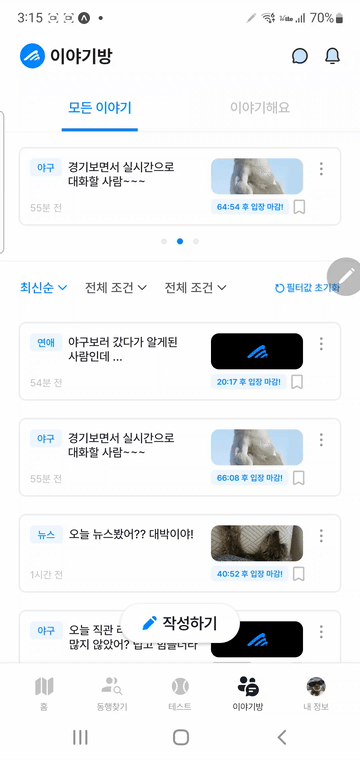 | 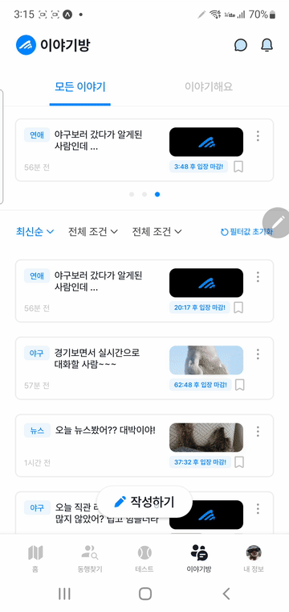 | 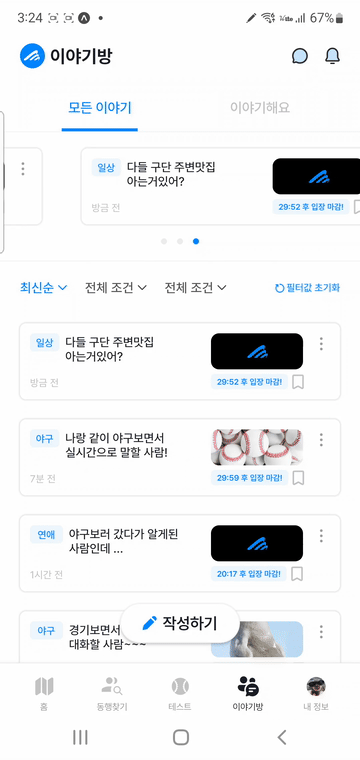 | 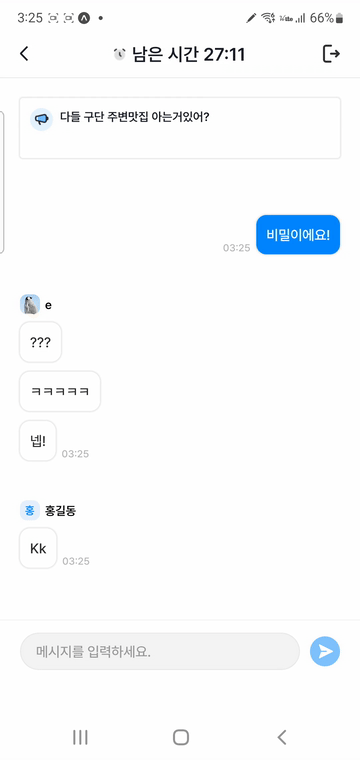 |

### 마이페이지

|                     프로필 변경                     |                     직관 기록                     |                     작성글                     |                    스크랩                     |                    차단글                     |                 로그아웃                  |
| :-------------------------------------------------: | :-----------------------------------------------: | :--------------------------------------------: | :-------------------------------------------: | :-------------------------------------------: | :---------------------------------------: |
| 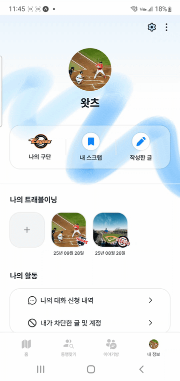 | 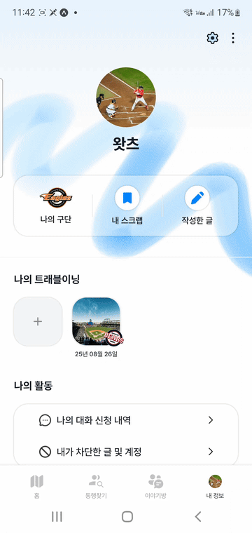 |  | 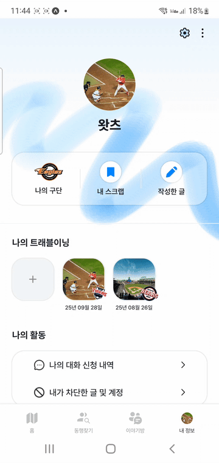 | 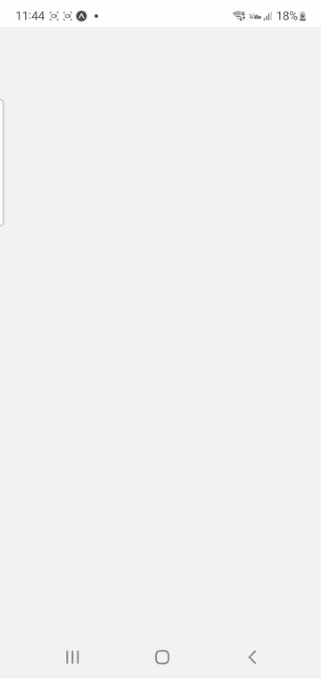 | 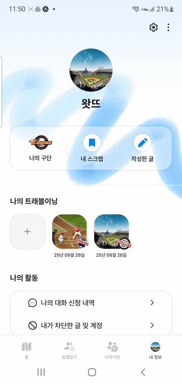 |

---

## 👥 팀 구성

| 역할     | 이름       | 담당            |
| -------- | ---------- | --------------- |
| 팀장     | 최효정     | 백엔드, 데이터  |
| 팀원     | 이윤경     | 데이터, AI 개발 |
| 팀원     | 이지혜     | 기획, 디자인    |
| **팀원** | **조은이** | **프론트엔드**  |
| 팀원     | 허지윤     | 프론트엔드      |

---

## 🛠️ 기술 스택

### Frontend

- **Framework**: React Native (Expo)
- **Language**: JavaScript
- **상태 관리**: AsyncStorage, SecureStore
- **네트워킹**: Axios
- **실시간 통신**: Socket.IO Client
- **UI/UX**: React Navigation

---

## 📂 프로젝트 구조

```
├── api/                    # API 통신 로직
│   ├── login/             # 로그인, 로그아웃, 비밀번호 변경
│   ├── signup/            # 회원가입 (SMS/Email 인증, 닉네임 중복체크)
│   ├── home/              # 홈 화면 데이터 (헤더, 장소 로드)
│   ├── companion/         # 동행찾기 게시글 CRUD
│   ├── storyroom/         # 이야기방 게시글 CRUD
│   ├── chat/              # 채팅 (동행찾기/이야기방)
│   ├── club/              # 구단 등록/조회
│   └── mypage/            # 마이페이지 (프로필, 스크랩, 차단, 계정 관리)
├── socket/                # Socket.IO 클라이언트 설정
├── utils/                 # 유틸리티 함수 (apiClient, auth 등)
├── component/             # 공통 컴포넌트 (Toast 등)
└── screens/               # 화면 컴포넌트
```

---

## 🔧 주요 기능 구현

### 1. JWT 기반 인증 시스템

**AccessToken + RefreshToken을 활용한 보안 인증 구현**

#### 로그인 흐름

```javascript
// 1. 이메일/비밀번호 → JWT AccessToken + RefreshToken 발급
// 2. AccessToken: AsyncStorage 저장
// 3. RefreshToken: SecureStore 저장 (보안 강화)
```

#### Axios Interceptor를 통한 자동 토큰 갱신

```javascript
// Request Interceptor: 모든 요청에 AccessToken 자동 삽입
apiClient.interceptors.request.use(async (config) => {
  const token = await AsyncStorage.getItem("accessToken");
  if (token) {
    config.headers.Authorization = `Bearer ${token}`;
  }
  return config;
});

// Response Interceptor: 401 에러 시 RefreshToken으로 재발급
apiClient.interceptors.response.use(
  (response) => response,
  async (error) => {
    if (error.response?.status === 401 && !originalRequest._retry) {
      // RefreshToken으로 AccessToken 재발급 시도
      // 성공 → 원래 요청 재시도
      // 실패 → 자동 로그아웃 처리
    }
    return Promise.reject(error);
  }
);
```

**핵심 포인트:**

- 401 에러 발생 시 사용자 인지 없이 자동으로 토큰 갱신
- RefreshToken 실패 시 자동 로그아웃으로 보안 강화
- 재시도 플래그(`_retry`)로 무한 루프 방지

---

### 2. 스플래시 화면 자동 로그인 로직

**앱 시작 시 토큰 유효성 검증 및 자동 라우팅**

```javascript
const boot = async () => {
  const hasOnboarded = await AsyncStorage.getItem("hasOnboarded");
  const accessToken = await AsyncStorage.getItem("accessToken");

  // 1. AccessToken 존재 시 프로필 조회로 토큰 유효성 검증
  if (accessToken) {
    try {
      const prof = await loadProfile();
      if (prof?.isSuccess && prof?.result) {
        // 유효한 토큰 → 사용자 정보 저장 후 메인 화면
        await AsyncStorage.setItem("userId", String(prof.result.memberId));
        await AsyncStorage.setItem("userName", String(prof.result.nickname));
        navigation.reset({ index: 0, routes: [{ name: "Main" }] });
        return;
      }
    } catch (e) {
      // 토큰 만료/오류 → 저장된 토큰 삭제
      await AsyncStorage.multiRemove(["accessToken", "userId", "userName"]);
    }
  }

  // 2. 토큰 없음 → 온보딩 완료 여부에 따라 분기
  if (hasOnboarded === "true") {
    navigation.reset({ index: 0, routes: [{ name: "LoginScreen" }] });
  } else {
    navigation.reset({ index: 0, routes: [{ name: "Onboarding" }] });
  }
};
```

**핵심 포인트:**

- 실제 API 호출(프로필 조회)로 토큰 유효성 검증
- 토큰 만료 시 자동으로 스토리지 정리
- 온보딩/로그인 상태에 따른 적절한 화면 라우팅

---

### 3. Socket.IO 실시간 채팅

**동행찾기(1:1/그룹) 및 이야기방 실시간 메시지 처리**

#### Socket 초기화 및 재연결 관리

```javascript
export const initSocket = (baseURL) => {
  socket = io(baseURL, {
    path: "/socket.io",
    transports: ["websocket", "polling"],
    reconnection: true, // 자동 재연결 활성화
    reconnectionAttempts: Infinity, // 무제한 재시도
    reconnectionDelay: 1000, // 1초 간격
  });

  // 연결 성공 시 대기 중인 메시지 전송
  socket.on("connect", () => {
    joinedRooms.clear();
    if (pendingQueue.length) {
      pendingQueue.forEach(({ event, payload, ack }) =>
        socket.emit(event, payload, ack)
      );
      pendingQueue = [];
    }
  });

  return socket;
};
```

#### 메시지 전송 (ACK 타임아웃 처리)

```javascript
export const sendMessageDual = async (displayRoomId, userId, message) => {
  const uuid = normalizeRoomId(displayRoomId);

  return new Promise((resolve) => {
    const payload = { roomId: uuid, senderId: userId, message };

    // 5초 타임아웃 설정
    let settled = false;
    const timer = setTimeout(() => {
      if (!settled) {
        settled = true;
        resolve(null); // ACK 없으면 null 반환
      }
    }, 5000);

    // 서버 ACK 대기
    socket.emit("sendMessage", payload, (serverMsg) => {
      if (!settled) {
        settled = true;
        clearTimeout(timer);
        resolve(serverMsg || null);
      }
    });
  });
};
```

**핵심 포인트:**

- 네트워크 끊김 시 자동 재연결 및 대기 메시지 전송
- ACK 타임아웃으로 무한 대기 방지
- UUID 정규화로 서버와의 호환성 보장

---

### 4. 채팅 기능별 구현

#### 동행찾기 채팅

- **1:1 채팅**: 게시글 작성자와 직접 소통
- **그룹 채팅**: 초대 코드를 통한 다중 참여자 관리
- **읽음 처리**: `lastMessageId` 기반 읽음 상태 업데이트
- **참여자 목록**: 실시간 그룹 채팅방 참여자 조회

#### 이야기방 채팅

- **제한 시간 관리**: 남은 시간 실시간 조회 (`remaining-seconds`)
- **참여 인원 표시**: 현재 참여자 수 실시간 업데이트
- **메시지 페이지네이션**: Cursor 기반 이전/다음 메시지 로드
- **자동 퇴장**: 제한 시간 종료 시 자동 처리

---

## 📡 API 명세

<details>
<summary><strong>인증 (Authentication)</strong></summary>

#### 로그인

- `POST /api/members/login`
- Body: `{ email, password }`
- Response: `{ jwt, refreshToken }`

#### 로그아웃

- `POST /api/members/auth/logout?token={accessToken}`

#### 토큰 갱신

- `GET /api/members/auth/refresh?refreshToken={refreshToken}`

#### 비밀번호 변경

- `POST /api/members/find/password`
- Body: `{ email, password }`

</details>

<details>
<summary><strong>회원가입 (Sign Up)</strong></summary>

#### SMS 인증

- `POST /api/members/sms/auth` - 인증번호 발송
- `POST /api/members/sms/auth/verify` - 인증번호 검증

#### 이메일 인증

- `POST /api/members/email/duplicate` - 이메일 중복 확인
- `POST /api/members/email/auth` - 인증번호 발송
- `POST /api/members/email/auth/verify` - 인증번호 검증

#### 닉네임 중복 확인

- `POST /api/members/nickname/duplicate`

#### 회원가입

- `POST /api/members/join`
- FormData: `{ data: {...}, profileImage }`

#### 여행 스타일 선택

- `POST /api/mypage/travel/style`
- Body: `{ styleOne, styleTwo }`

</details>

<details>
<summary><strong>홈 (Home)</strong></summary>

#### 헤더 정보 조회

- `GET /api/home/header?teamId={teamId}`

#### 장소 목록 조회

- `GET /api/stadium-attractions`
- Params: `teamId, styleIds, myScrapOnly, unpaged, limit, sort`

</details>

<details>
<summary><strong>동행찾기 (Companion)</strong></summary>

#### 게시글 목록 조회

- `GET /api/companionPost/list`
- Params: `page, size, sort, sortType, statusFilter`

#### 게시글 작성

- `POST /api/companionPost/create`
- Params: `title, content, status, postType`
- FormData: `imageFiles[]`

#### 게시글 상세 조회

- `GET /api/companionPost/{postId}` (인증)
- `GET /api/companionPost/public/{postId}` (비인증)

#### 게시글 수정

- `PUT /api/companionPost/{postId}`

#### 게시글 삭제

- `DELETE /api/companionPost/{postId}`

#### 게시글 상태 변경

- `PATCH /api/companionPost/{postId}/status`

#### 게시글 검색

- `GET /api/companionPost/search?keyword={keyword}`

</details>

<details>
<summary><strong>이야기방 (Story Room)</strong></summary>

#### 게시글 작성

- `POST /api/storyRoom/post/create`
- Params: `title, content, topic, limitTime`
- FormData: `imageFiles[]`

#### 게시글 목록 조회

- `GET /api/storyRoom/post/list`
- Params: `status, sortType, topic`

#### 게시글 상세 조회

- `GET /api/storyRoom/post/{postId}` (인증)
- `GET /api/storyRoom/post/public/{postId}` (비인증)

#### 게시글 삭제

- `DELETE /api/storyRoom/post/{postId}`

</details>

<details>
<summary><strong>채팅 (Chat)</strong></summary>

#### 동행찾기 채팅

- `GET /api/chats/companion/active-posts` - 내 게시글 목록
- `GET /api/chats/companion/{postId}/active-rooms` - 게시글별 채팅방 목록
- `GET /api/chats/companion/{postId}/header` - 게시글 헤더
- `GET /api/companion/chats/rooms/{roomId}/messages` - 메시지 조회
- `POST /api/companion/chats/rooms/OneOnOne?postId={postId}` - 1:1 채팅방 생성
- `POST /api/companion/chats/rooms/invite` - 그룹 채팅방 생성
- `POST /api/companion/chats/rooms/joinByInvite` - 초대 코드로 입장
- `POST /api/chats/rooms/{roomId}/leave` - 채팅방 나가기
- `POST /api/chats/rooms/{roomId}/read` - 읽음 처리
- `GET /api/chats/rooms/{roomId}/participants/others` - 참여자 목록

#### 이야기방 채팅

- `POST /api/story/chats/rooms/{roomId}/enter` - 입장
- `POST /api/story/chats/rooms/{roomId}/leave` - 퇴장
- `GET /api/story/chats/rooms/{roomId}/messages` - 메시지 조회
- `GET /api/story/chats/rooms/{roomId}/remaining-seconds` - 남은 시간
- `GET /api/story/chats/rooms/{roomId}/participants/count` - 참여 인원

</details>

<details>
<summary><strong>마이페이지 (MyPage)</strong></summary>

#### 프로필

- `GET /api/mypage/my/profile` - 프로필 조회
- `PUT /api/mypage/profile/modify` - 프로필 수정
- `PUT /api/mypage/profile-image/upload` - 프로필 이미지 업로드

#### 구단 관리

- `GET /api/mypage/teams` - 선호 구단 조회
- `POST /api/mypage/teams/{teamId}` - 구단 등록

#### 나의 게시글

- `GET /api/mypage/companion-posts` - 동행찾기 게시글
- `GET /api/mypage/story-posts` - 이야기방 게시글

#### 직관 이닝 (여행 일지)

- `GET /api/mypage` - 목록 조회
- `POST /api/mypage` - 기록 작성

#### 스크랩

- `POST /api/travel/regions/{id}/scrap` - 장소 스크랩
- `DELETE /api/travel/regions/{id}/scrap` - 장소 스크랩 취소
- `GET /api/mypage/scraps/travel-regions` - 스크랩한 장소
- `POST /api/companionPost/scrap/{postId}` - 게시글 스크랩
- `DELETE /api/companionPost/scrap/{postId}` - 게시글 스크랩 취소
- `GET /api/mypage/scraps/companion-posts` - 스크랩한 동행찾기 게시글
- `POST /api/storyRoom/post/scrap/{postId}` - 이야기방 스크랩
- `DELETE /api/storyRoom/post/scrap/{postId}` - 이야기방 스크랩 취소
- `GET /api/mypage/scraps/story-posts` - 스크랩한 이야기방

#### 차단

- `POST /api/travel/regions/{id}/block` - 장소 차단
- `DELETE /api/travel/regions/{id}/block` - 장소 차단 해제
- `GET /api/mypage/blocked/travel-regions` - 차단한 장소
- `POST /api/companionPost/{postId}/block` - 게시글 차단
- `DELETE /api/companionPost/{postId}/block` - 게시글 차단 해제
- `GET /api/mypage/blocked/companion-posts` - 차단한 동행찾기 게시글
- `POST /api/storyRoom/post/block/{postId}` - 이야기방 차단
- `DELETE /api/storyRoom/post/block/{postId}` - 이야기방 차단 해제
- `GET /api/mypage/blocked/story-posts` - 차단한 이야기방

#### 계정

- `DELETE /api/mypage/delete` - 계정 삭제

</details>

---

## 🎯 트러블슈팅

> 작성 예정

---

## 📚 협업 도구

- **디자인**: Figma
- **커뮤니케이션**: notion, discord, 카카오톡
- **API 문서**: Swagger (현재 서버 중단)
- **버전 관리**: Git/GitHub

---

## 📌 비고

- 현재 백엔드 서버가 중단된 상태로 앱이 작동하지 않아 APK는 별도로 제공하지 않습니다.
- Swagger 문서 접근 불가로 API 명세는 프론트엔드 코드에서 추출하였습니다.
- 본 레포지토리는 프론트엔드 전용 레포지토리입니다.

---

## 📄 License

이 프로젝트는 개인 포트폴리오 목적으로 작성되었습니다.
